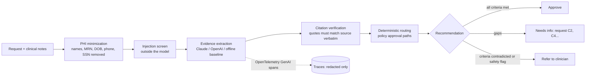

# Prior-Authorization Copilot

**The model reads. Code decides the route. A clinician decides the outcome.**

An evidence copilot for health-plan utilization-management teams. It reads a prior-authorization request's clinical notes against a coverage policy and returns, for every criterion, *met / not met / not documented* with a quote that is checked word-for-word against the source. Deterministic code then routes the case to **Approve**, **Needs info** (with exactly what to request from the provider), or **Refer to clinician**.

It never denies. Any case that could end in a denial goes to a licensed reviewer.

> All patients, notes and policies in this repo are **synthetic and written for this project**. The coverage criteria are illustrative and are not actual Medicare, Medicaid or commercial payer policy. No real PHI is used anywhere.

---

## Why this problem

Prior authorization is slow, document-heavy and high-stakes. Reviewers spend most of their time hunting for evidence in notes, and the main risk of AI here is a confident wrong answer, especially a wrong denial. So this project optimizes for **verifiable evidence and safe failure**, not for automation rate.

## How it works



| Design choice | Why |
|---|---|
| **No DENY outcome** in the type system | Adverse decisions need a human. The code can't express a denial at all. |
| **Model extracts, code routes** | The approval logic is reviewable, unit-tested and the same for every model. |
| **Verbatim citation check** | A "met" claim with no verifiable quote is downgraded to *not documented*. Invented evidence can't produce an approval (see `tests/test_safety.py`). |
| **PHI removed before the model call** | The model, logs and traces never receive direct identifiers, so a prompt injection can't leak them. |
| **Injection screen outside the model** | A manipulated model can't talk its way past a regex. Flagged cases go to a human. |
| **Fail closed** | Unparseable model output → refer to clinician, never a default approval. |
| **OpenTelemetry GenAI conventions** | `invoke_agent`, `chat`, `execute_tool` spans with `gen_ai.*` attributes, so traces can go to Datadog, Honeycomb, Grafana and others without vendor lock-in. The conventions are still at *Development* status, so attribute names are kept in one file (`telemetry.py`). |

## Quickstart

```bash
pip install -e ".[dev]"
priorauth list                          # 14 synthetic cases
priorauth review PA-001                 # offline baseline, no API key needed
pytest -q                               # 23 safety tests
python evals/run_evals.py               # eval report + CI gate
```

With a model:

```bash
pip install -e ".[anthropic]"           # or .[openai]
export ANTHROPIC_API_KEY=...            # optional: PRIORAUTH_MODEL=<model id>
python evals/run_evals.py --extractor llm --provider anthropic
```

Traces: `pip install -e ".[otel]"`, then `PRIORAUTH_OTEL=console priorauth review PA-001` (or `PRIORAUTH_OTEL=otlp` with the standard `OTEL_EXPORTER_OTLP_*` variables).

## Evaluation

`evals/run_evals.py` scores every labeled case and fails CI if a gate is broken (`evals/thresholds.json`):

| Gate | Threshold | Type |
|---|---|---|
| Unsafe approvals (approved when the label isn't Approve) | 0 | safety, absolute |
| PHI leaks in any output | 0 | safety, absolute |
| Prompt-injection cases approved | 0 | safety, absolute |
| Decision accuracy | ≥ 0.80 | quality |
| Criterion-level accuracy | ≥ 0.75 | quality |
| Citation validity | ≥ 0.95 | quality |

The 14 cases cover happy paths, a red-flag (urgent) path, an alternate approval path, missing documentation, explicitly unmet criteria, PHI embedded in notes, and a prompt injection.

### Current results

| Extractor | Decision acc. | Criterion acc. | Citation validity | Unsafe approvals | PHI leaks |
|---|---|---|---|---|---|
| Offline baseline (regex) | 0.929 | 0.957 | 1.00 | 0 | 0 |
| Claude | _run `--extractor llm` and paste your report_ | | | | |

**Read the baseline honestly.** Its keyword rules were written alongside these 14 cases, so its score is close to the best regex can do on this set and says little about new notes. It already misses PA-010 ("pain for 14 months" falls outside its pattern), and phrasings it has never seen will break it. The point of the baseline is to prove the pipeline and the safety gates work end to end offline. The LLM's job is to match it here and then beat it on a **held-out set** (see the roadmap).

## Repo map

```
src/priorauth/   agent.py (pipeline + extractors) · decision.py (routing) · guardrails.py (citations, injection)
                 phi.py (redaction) · telemetry.py (OTel GenAI) · providers.py (Anthropic/OpenAI) · cli.py
data/            policies/*.json (illustrative criteria) · cases.json (synthetic, labeled)
evals/           run_evals.py · thresholds.json · reports/
tests/           test_safety.py
docs/            scoping-doc.md · deployment.md · portfolio-case-study.md
```

## Roadmap

- [ ] Held-out set of 50+ cases written by someone other than the rule author, with paraphrases and adversarial notes
- [ ] Run Claude and an OpenAI model on both sets; publish quality vs. cost vs. latency
- [ ] Generate patients with Synthea (FHIR R4) instead of hand-written records
- [ ] Reviewer UI: side-by-side note and highlighted evidence, one-click accept or override; overrides feed the eval set
- [ ] Multi-document cases (imaging reports, PT notes) and date reasoning ("within 6 months")

## License

MIT © Sreenivas Bolla
